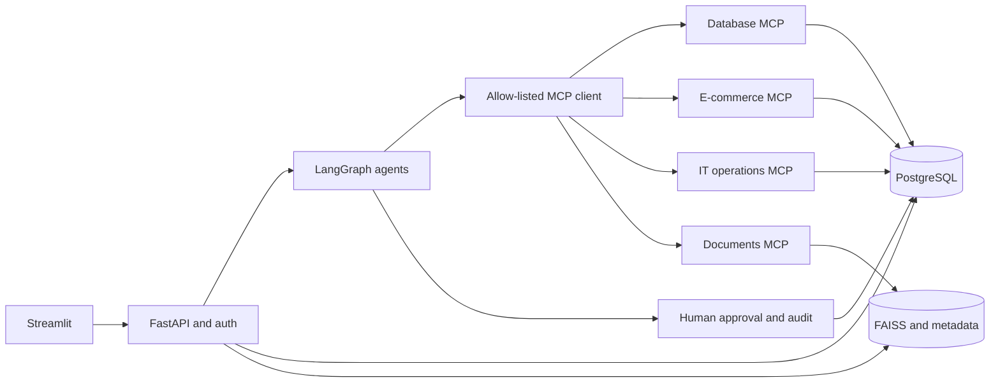

# OpsPilot AI — Final Project Report

**Prepared:** 2026-11-18  
**Project identity:** OpsPilot AI, branded as Operlynt in the application  
**Repository description:** Agentic business operations intelligence with LangGraph workflows, MCP tools, PostgreSQL analytics, and source-cited RAG.

## Project overview

OpsPilot AI brings e-commerce and IT operations metrics, business records, policy/runbook search, AI-assisted investigations, and human-approved operational actions into a single Streamlit workspace backed by FastAPI. The implementation is prepared for local use and Docker Compose deployment. No remote hosting deployment has been performed.

## Architecture

The Streamlit UI calls the authenticated FastAPI service. Investigation endpoints execute LangGraph state graphs that route requests to domain agents and, when relevant, analytics, historical research, RAG, decision synthesis, and an approval-gated execution agent. Agents discover and invoke MCP tools through a per-agent allow-list.

Four MCP servers expose database analytics, e-commerce lookups/actions, IT ticket and incident operations, and document retrieval. Direct local development uses stdio MCP subprocesses. Docker Compose uses private Streamable HTTP MCP services. PostgreSQL stores relational/business records, accounts, approvals, and audit data in Compose; local development defaults to SQLite. FAISS indexes, uploads, workflow checkpoints, and Hugging Face model cache use persistent storage paths/volumes.

See [docs/ARCHITECTURE.md](docs/ARCHITECTURE.md) for component and persistence detail.

## Implemented modules and working features

- **API and access control:** FastAPI routes, JWT login/registration, role-protected analytics and operational routes, liveness and database-readiness probes.
- **Operations data:** SQLAlchemy models for users, products, sellers, orders, complaints, inventory, tickets, incidents, approvals, agent logs, and audit events. Startup seeds synthetic development records.
- **Agents and workflows:** Shared typed LangGraph state, domain routing, evidence collection, workflow status, conversation state, retry/error recording, and approval interrupts.
- **MCP services:** Four official MCP SDK server modules; tool discovery, runtime clients, MCP error normalization, agent allow-lists, validated arguments, approval-gated writes, and local stdio protocol integration.
- **RAG:** PDF/TXT ingestion, duplicate detection, chunking, Hugging Face embedding adapter, FAISS collections, similarity search, and source/citation metadata.
- **Human approvals:** Pending/rejected/approved records, conditional single-resolution updates, approved tool execution, execution status, and audit events.
- **Workspace:** Streamlit dashboards for operations, AI chat, RAG documents, monitoring, approvals, tickets, and settings.
- **Observability:** Structured JSON events for API, workflow, agent, provider, MCP, and approval operations; request/workflow identifiers; elapsed times; safe error fields; and token counts when providers return usage metadata.
- **Deployment and repository setup:** Python 3.11 Docker image, Compose services/volumes/health checks, environment example, Docker/Git ignores, deployment and architecture docs, CI workflow, evaluation datasets, and this report.

## Technologies

Python 3.11 target, FastAPI, Uvicorn, Pydantic, SQLAlchemy, PostgreSQL 16, SQLite, LangGraph, LangChain, Groq/OpenRouter adapters, Hugging Face Sentence Transformers, FAISS, MCP Python SDK, Streamlit, Pandas, Plotly, pytest, Ruff, GitHub Actions, Docker, and Docker Compose.

## Test and quality results

The final local full test run completed on Windows/Python 3.13.7:

- **60 tests collected**
- **59 passed**
- **1 skipped**
- **0 failed**
- **120.51 seconds**

The skip is the actual model download/inference integration test, gated by `RUN_HF_MODEL_TESTS=1` to keep normal offline local testing deterministic. A local embedding adapter test passed. CI sets this flag and caches the Hugging Face model, but CI has not yet run.

After the full run, the user's startup traceback revealed the active Python 3.11 venv had resolved `mcp==1.9.2` alongside `pydantic==2.14.3`. The MCP dependency is now pinned to `mcp==1.29.1`, whose FastMCP metadata module no longer imports Pydantic's removed internal helper. The complete suite has **not yet been rerun with MCP 1.29.1**; reinstall dependencies and rerun the tests to verify this revised dependency set locally.

Python compile and application import checks passed. API liveness and SQLite readiness tests passed. The full suite includes MCP local server/database integration, API auth/roles, approvals, workflow routing, ingestion/retrieval, and Streamlit render/client checks. The most recent test summary is in [evaluation/REPORT.md](evaluation/REPORT.md).

## AI evaluation results

The deterministic agent evaluator ran three curated cases:

- Agent plan exact match: **3/3**.
- RAG tool selection accuracy: **3/3**.

These results apply only to the current keyword-based router and tool selector. The manually curated RAG query/document dataset exists, and Precision@K, Recall@K, MRR, context relevance, lexical groundedness, SQL exact correctness, task/workflow completion, unsupported-claim, and action execution metrics are implemented. The live RAG evaluator and broader labeled answer-quality metrics have not been run, so no scores are claimed for them.

## Performance results

Small local sequential smoke measurements:

- FastAPI `GET /health`: 20 requests, **5.03 ms median client elapsed**, **5.877 ms P95**, all HTTP 200.
- Database MCP `get_return_statistics`: 5 calls, **23.55 ms median**; first startup/discovery call **5.18 seconds**, four warm calls approximately 20–24 ms.
- RAG retrieval and representative full workflow throughput: **not measured**.

These numbers are not load tests or service-level objectives. Details and environment are in [evaluation/performance_results.json](evaluation/performance_results.json).

## Deployment status

**Configuration prepared; deployment not performed.** Docker Compose declares PostgreSQL, FastAPI, Streamlit, four internal MCP services, persistent volumes, and liveness/readiness/protocol health checks. `docker compose config --quiet` validated with temporary process-only placeholder secrets. Local Streamlit started and `/_stcore/health` returned HTTP 200. MCP stdio connectivity passed through automated tests.

Docker image build and Compose container/PostgreSQL/MCP health validation could not be completed: Docker Engine was not running/reachable (`dockerDesktopLinuxEngine` named pipe was absent). Ruff is included in CI but was not installed locally, and GitHub Actions has not been run. No hosted deployment was verified. See [docs/DEPLOYMENT.md](docs/DEPLOYMENT.md).

## Security and publication notes

- `.env` is ignored by Git and excluded from Docker build context; `.env.example` contains blank secret fields.
- No API keys, passwords, local databases, vector indexes, uploaded files, or model caches are intentionally included in images or source control.
- Compose exposes only API/UI ports and binds to localhost by default; MCP services remain private to the Compose network.
- Before public exposure, configure TLS/reverse proxy and firewall policy, managed secrets and rotation, durable encrypted backups, external identity, shared rate limiting, and protected API documentation.
- No license was selected or added. Add a LICENSE only after choosing the intended reuse terms.
- UI screenshots have not yet been captured; the README provides a labeled screenshots section rather than invented UI images.

## Known limitations

- Live Hugging Face model integration is delegated to CI and was skipped locally; RAG evaluation dataset has not been scored.
- Current AI evaluation data is small. Production answer groundedness, unsupported claims, and SQL analytical correctness need a larger human-reviewed gold dataset.
- Performance tests do not include PostgreSQL containers, live providers, RAG workloads, or concurrent traffic.
- Rate-limit/provider outage, remote MCP disconnect, database outage, and approval timeout fault-injection coverage is incomplete.
- Password throttling is process-local; there is no external SSO, tenant isolation, migration framework, or central metrics/log aggregation backend.
- Existing FastAPI, SQLAlchemy, and LangGraph dependency deprecation warnings remain.

## Future roadmap

1. Run GitHub Actions and the live model integration on a hosted CI runner; address any environment-specific failures.
2. Build and verify the Compose stack on a Docker-enabled Linux host, then document restore/upgrade tests.
3. Expand curated evaluations for retrieval, SQL outputs, grounded answers, workflow completion, and approval outcomes.
4. Add migrations, external identity/SSO, tenant isolation, and shared rate limiting.
5. Add tracing/metrics export, alerting, concurrency/performance tests, and operational dashboards.
6. Select a license, capture actual screenshots, and publish an end-to-end demo only after hosting verification.

1st terminal - python -m uvicorn api.main:app --host 127.0.0.1 --port 8000

2nd terminal - python -m streamlit run frontend\app.py