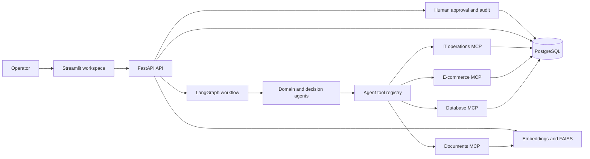
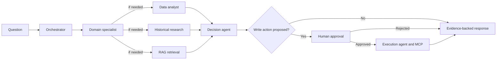
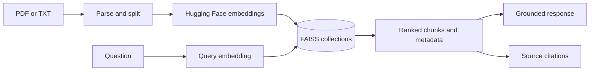

# OpsPilot AI (Operlynt)


**Suggested GitHub description:** Agentic business operations intelligence with LangGraph workflows, MCP tools, PostgreSQL analytics, and source-cited RAG.

OpsPilot AI, branded in the application as Operlynt, is a portfolio-ready operations intelligence platform. It combines e-commerce and IT operations data, policy and runbook search, AI-assisted investigation, and human-approved actions in one workspace. Demo mode uses deterministic, clearly labeled responses and does not require a live LLM API.

> **Deployment status:** Deployment configuration is prepared. The project has not been deployed to a hosting provider. See [deployment documentation](docs/DEPLOYMENT.md) and the [final project report](FINAL_PROJECT_REPORT.md) for verified checks and limitations.

## Business problem

Operations teams often investigate an issue across database reports, ticketing records, runbooks, and approval systems. These separate tools make it harder to assemble evidence, cite the source of a recommendation, and ensure operational changes receive human review. OpsPilot AI brings those steps into a single, auditable workflow.

## Key features

- E-commerce reporting for returns, inventory, complaints, products, and sellers.
- IT operations reporting for tickets, incidents, severity, and recurring categories.
- LangGraph agents that route work to domain investigators, analytics, historical research, RAG, and decision synthesis.
- PDF/TXT ingestion, Hugging Face sentence embeddings, FAISS vector search, and source metadata for citations.
- Four MCP servers with runtime tool discovery, per-agent allow-lists, and approval-gated write operations.
- JWT authentication, roles, approval records, execution status, and audit events.
- FastAPI service and Streamlit operations workspace.
- JSON application events and deterministic evaluation helpers and datasets.

## Architecture



Docker Compose runs PostgreSQL, the API, Streamlit, and four private MCP services. Local Python development defaults to MCP stdio subprocesses. See [architecture details](docs/ARCHITECTURE.md).

## Technology stack

| Layer | Technology |
| --- | --- |
| API | FastAPI, Pydantic, Uvicorn |
| Orchestration | LangGraph |
| Models | Groq or OpenRouter through LangChain; deterministic demo provider |
| Retrieval | Hugging Face Sentence Transformers, LangChain embeddings, FAISS |
| Data and approvals | SQLAlchemy, SQLite locally, PostgreSQL in Compose |
| Agent tools | Official Python MCP SDK, stdio locally and Streamable HTTP in Compose |
| Workspace | Streamlit, Pandas, Plotly |
| Testing and CI | pytest, GitHub Actions, Ruff critical-error checks |
| Packaging | Python 3.11 container, Docker Compose |

## Multi-agent workflow

The orchestrator classifies the request and selects a domain specialist and evidence agents. The graph can gather SQL analytics, historical records, and retrieved documents, then passes their results to the decision agent. Proposed write actions pause for human approval before the execution agent calls an allow-listed MCP tool. Agent failures are retried once and represented in workflow state.



## MCP architecture

MCP tools are registered by separate server modules and discovered through the MCP protocol. The agent tool registry applies role-specific allow-lists; write tools require approved execution context. Local clients spawn stdio servers. Compose runs the same servers as Streamable HTTP services on the private Compose network; they are not published to host ports.

| MCP server | Responsibilities |
| --- | --- |
| Database | Read-only return, inventory, support, and complaint metrics |
| E-commerce | Order, product, seller lookups and approved escalation writes |
| IT operations | Ticket and incident lookup plus approved ticket/escalation writes |
| Documents | Policy, technical documentation, and historical incident search |

## RAG pipeline



The default model is `sentence-transformers/all-MiniLM-L6-v2`. Collections separate e-commerce policy, IT documentation, historical incidents, and general files. Local mode stores FAISS data under `data/vector_store`; Compose mounts a persistent named volume shared by the API and document MCP server. The first real embedding use may download model files from Hugging Face.

## Database schema overview

SQLAlchemy models define users, products, sellers, orders, complaints, inventory, tickets, incidents, approvals, agent logs, and audit events. SQLite is the direct-run default. Docker Compose uses PostgreSQL 16. Seed data is synthetic and intended for development and demonstrations.

## Installation and local run

Requirements: Python 3.11, Windows CMD or another supported shell. From the project directory:

```cmd
py -3.11 -m venv .venv
.venv\Scripts\activate.bat
python -m pip install --upgrade pip
pip install -r requirements.txt
copy .env.example .env
```

For an existing virtual environment, refresh the pinned versions with `python -m pip install --upgrade -r requirements.txt`. MCP is pinned to a release compatible with the installed Pydantic API.

Edit `.env` and set distinct random values for `API_TOKEN` and `JWT_SECRET`. To generate a value in Windows CMD:

```cmd
py -3.11 -c "import secrets; print(secrets.token_hex(32))"
```

Set `DEMO_MODE=true` to use the no-key simulated LLM provider. Start the API:

```cmd
uvicorn api.main:app --host 127.0.0.1 --port 8000 --reload
```

Open a second CMD window for the frontend:

```cmd
cd /d C:\path\to\OpsPilot-AI
.venv\Scripts\activate.bat
set OPERLYNT_API=http://127.0.0.1:8000
streamlit run frontend\app.py
```

FastAPI creates schema and seeds the local database at startup. Set `DATABASE_URL` if you want to use a separate PostgreSQL instance. For production-like deployment prefer Compose and a managed secrets system.

## Environment configuration

`.env.example` lists supported settings. Compose requires non-empty `POSTGRES_PASSWORD`, `API_TOKEN`, and `JWT_SECRET`. Use independently generated values; choose a URL-safe PostgreSQL password (hex output from `secrets.token_hex` works). Never commit `.env` or paste credentials into issue reports.

| Variable | Purpose |
| --- | --- |
| `DEMO_MODE` | Uses deterministic no-network LLM behavior when `true` |
| `LLM_PROVIDER`, `GROQ_API_KEY`, `OPENROUTER_API_KEY` | Optional live chat model selection and credentials; required only for live LLM mode |
| `API_TOKEN`, `JWT_SECRET`, `JWT_EXPIRE_MINUTES` | Legacy system token compatibility and JWT signing configuration |
| `ADMIN_BOOTSTRAP_KEY` | Allows manager/admin account bootstrap |
| `POSTGRES_PASSWORD`, `DATABASE_URL` | Compose PostgreSQL password and application SQL connection |
| `CORS_ORIGINS` | Browser origins accepted by the API |
| `API_BIND`, `API_PORT`, `FRONTEND_PORT` | Compose host bind address and published ports; localhost is the default |
| `OPERLYNT_API` | API URL used by Streamlit; Compose sets its internal service URL |
| `OPERLYNT_MCP_<SERVER>_URL` | Optional remote MCP Streamable HTTP endpoint; local default is stdio |
| `VECTOR_DIR`, `UPLOAD_DIR`, `WORKFLOW_CHECKPOINT_PATH` | Persistent vector, uploaded document, and checkpoint paths |
| `EMBEDDING_MODEL`, `RAG_*` | Embedding selection and retrieval/chunking controls |

For `DEMO_MODE=false`, configure a valid provider key and random secrets of at least 32 characters. In hosted environments, use the platform’s secret store or mounted Docker secrets; restrict access and rotate credentials. A `.env` file is a local development mechanism, not a managed production vault.

## Docker Compose

Docker Desktop with Compose v2 is required. Copy `.env.example` to `.env`, populate the three required Compose secrets and any provider credentials, then:

```cmd
copy .env.example .env
notepad .env
docker compose config --quiet
docker compose up --build -d
docker compose ps
```

Open the UI at `http://localhost:8501`; the API docs are at `http://localhost:8000/docs`. The API and frontend host bindings default to `127.0.0.1`. Change `API_BIND=0.0.0.0` only when the host firewall and TLS reverse proxy are configured. MCP ports stay on the internal Compose network.

Named volumes preserve PostgreSQL data, FAISS indexes, document uploads, workflow checkpoints, and Hugging Face model cache. Back up volumes before upgrades. `docker compose down` retains named volumes; `docker compose down -v` deletes them and is destructive.

Each service has a health check: PostgreSQL uses `pg_isready`, API readiness executes a database query, frontend checks Streamlit health, and MCP services perform protocol tool discovery. See [deployment configuration and secret guidance](docs/DEPLOYMENT.md).

## API documentation

When the API is running:

- Interactive OpenAPI UI: `http://localhost:8000/docs`
- OpenAPI schema: `http://localhost:8000/openapi.json`
- Liveness: `GET /health`
- Database readiness: `GET /health/ready`
- Authentication: `/api/auth/register`, `/api/auth/login`, `/api/auth/me`
- Investigations: `/api/chat`, `/api/ecommerce/investigate`, `/api/it/investigate`
- Retrieval: `/api/rag/ask`, `/api/rag/upload`, `/api/rag/documents`, `/api/rag/health`
- Approvals, tickets, analytics, workflow state, and execution status: see OpenAPI routes and [architecture documentation](docs/ARCHITECTURE.md).

Most operational endpoints require a bearer JWT. Upload and write operations have stricter role requirements. Do not publish the interactive API docs on an untrusted public endpoint without access controls.

## Screenshots

Screenshots have not yet been captured and committed. Add reviewed images under `docs/images/` and link them here before publishing a visual portfolio entry. No mock screenshots are presented as live application output.

## Evaluation and test results

The deterministic agent evaluation executed three manually curated routing cases: agent selection exact match **3/3**, RAG tool selection **3/3**. This measures keyword planner/selector behavior only. It is not a quality score for live LLM output.

The final local suite collected 60 tests: **59 passed, 1 skipped, 0 failed**. The skipped test performs real Hugging Face model download/inference and is gated behind `RUN_HF_MODEL_TESTS=1`; CI is configured to run it with model caching, but that CI run has not yet been observed. Live RAG retrieval metrics were not measured. Local smoke measurements: 20 API `/health` requests had 5.03 ms median client elapsed time (5.877 ms P95); five database MCP calls had 23.55 ms median, with the first startup call at about 5.18 seconds. These small sequential samples are not load tests or service-level objectives. See [evaluation/REPORT.md](evaluation/REPORT.md) for full details and [FINAL_PROJECT_REPORT.md](FINAL_PROJECT_REPORT.md) for project status.

## Security considerations

- Keep API keys, passwords, database URLs with credentials, and local `.env` files out of Git and container build contexts.
- The API uses JWT authentication and role checks; keep the legacy `API_TOKEN` private.
- Use random secrets, TLS, restrictive CORS, host firewalls, and secret rotation before external exposure.
- MCP services are private by default in Compose; remote MCP connections need authenticated TLS at the deployment boundary.
- Operational writes use human approvals and are audited. Demo data is synthetic.
- Current password request throttling is process-local. Use a shared rate limiter and external identity provider for a multi-instance production service.
- Persist and protect PostgreSQL, upload, vector-store, model-cache, and workflow checkpoint volumes.

## Known limitations

- No hosting-provider deployment has been performed or verified.
- The live Hugging Face model integration test is opt-in locally; set `RUN_HF_MODEL_TESTS=1` to run it. First-time model download needs network access; no API key is needed for embeddings.
- The recorded 60-test run used the previously installed MCP 1.9.2; `requirements.txt` now pins MCP 1.29.1 to address a Pydantic 2.14 import mismatch. Rerun tests after refreshing dependencies.
- The RAG evaluation harness was not run in the recorded validation.
- Agent evaluation covers three deterministic routing examples. SQL result correctness, live answer groundedness, unsupported claims, and workflow success lack a sufficiently broad labeled corpus.
- Performance is limited to local API-health and database-MCP smoke measurements; no concurrent load or end-to-end workflow benchmark was run.
- Seeded operational records are synthetic. There is no external SSO, tenant isolation, production migration framework, or centralized observability backend yet.

## Future improvements

- Run the configured GitHub Actions workflow, including its cached Hugging Face model integration test.
- Expand labeled RAG/agent datasets and add SQL correctness fixtures and unsupported-claim review.
- Add database migrations, external identity/SSO, shared rate limiting, and tenant-aware authorization.
- Add tracing/metrics export, log aggregation, alerting, and concurrency/load tests.
- Provide infrastructure-as-code for a selected cloud platform and an automated backup/restore runbook.
- Capture actual UI screenshots and publish a demo walkthrough after an end-to-end deployment is verified.

## CI

GitHub Actions runs on pushes, pull requests, and manual dispatch. It sets up Python 3.11, installs application/test dependencies, runs Ruff critical-error and undefined-name checks, compiles modules, imports the application modules, and runs pytest with a timeout. No provider credentials are required in CI; `DEMO_MODE=true` is used.
